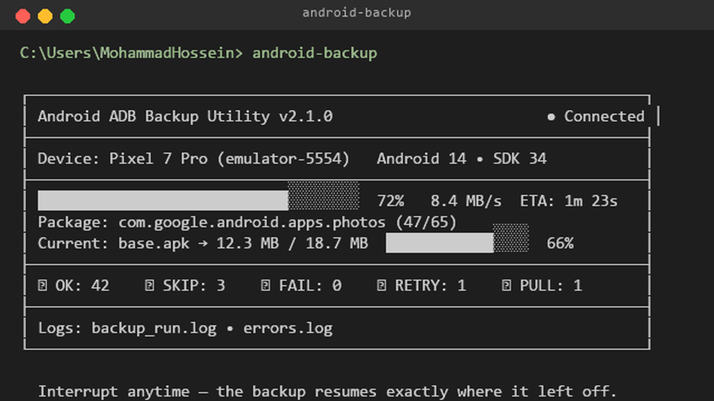
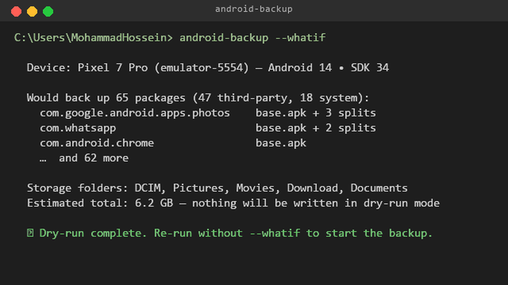
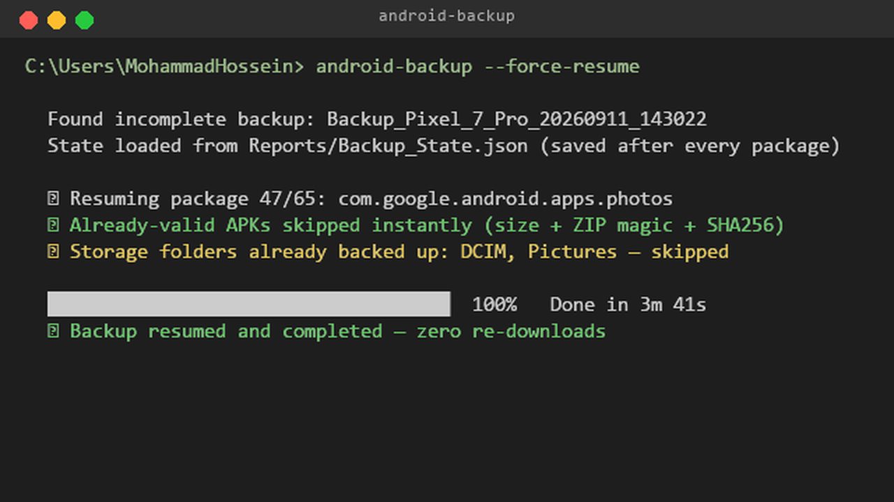
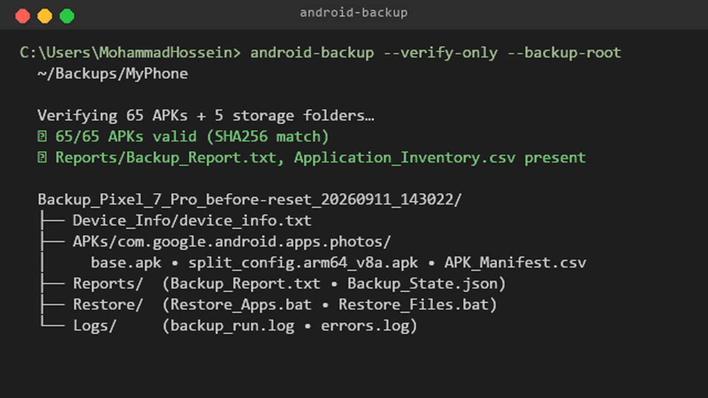

# ابزار بک‌آپ ADB اندروید

> **چندرسانه‌ای، غیرتخریبی، قابل ادامه** ابزار بک‌آپ اندروید با رابط ترمینال زنده زیبا.

[
[
[
[

---

## ✨ ویژگی‌ها

- **🎨 رابط ترمینال زنده زیبا** — نوارهای پیشرفت بلادرهنگام، وقت‌تخمین، شمارنده‌های زنده، پنل‌های رنگی
- **🔄 کاملاً قابل ادامه** — هر زمانی متوقف‌شده، از دقیقاً همان نقطه ادامه بگیرد
- **📦 بک‌آپ کامل APK** — APK‌های اصلی + APK‌های تقسیم‌شده (تقسیم‌بندی پیکربندی، معماری، زبان)
- **🛡️ غیرتخریبی** — عملیات‌های فقط‌خوان ADB، هرگز دستگاه را تغییر نمی‌دهد
- **💾 بک‌آپ ذخیره‌ساز** — پوشه‌های رایج (DCIM، Pictures، Movies، Download، Documents، Music، Android/media) + اختیاری تمام `/sdcard`
- **🔍 حالت‌های پیش‌نمایش و تأیید** — پیش‌بینی آنچه بک‌آپ خواهد شد، تأیید یکپارچگی بک‌آپ موجود
- **📊 گزارش‌های غنی** — گزارش متنی، سرشماری CSV، وضعیت JSON برای خودکارسازی
- **🔧 چندرسانه‌ای** — پشتیبانی بومی ویندوز، مک، لینوکس
- **📦 نصب آسان** — `pip install` یا اجرایی واحد از طریق PyInstaller

---

## 🖼️ اسکرین‌شات‌ها

همه از خروجی خط فرمان مستند گرفته شده‌اند (تولید مجدد با `scripts/make-cli-screenshots.py` در پوشه پرتفوی):

| رابط ترمینال زنده | نقشه‌ی پیش‌نمایش |
|:---:|:---:|
|  |  |
| **ادامه خودکار** | **تأیید و ساختار** |
|  |  |

---

## 🚀 شروع سریع

### نصب

```bash
# از طریق pip (توصیه‌شده)
pip install android-adb-backup

# یا از طریق pipx (محیط ایزوله)
pipx install android-adb-backup

# یا دانلود اجرایی واحد از انتشارات گیت‌هاب
```

### پیش‌نیازها

- **دستگاه اندروید** با دیباگ USB فعال
- **پایتون ۳.۹+** (برای نصب pip) — *برای اجرایی واحد لازم نیست*
- **ADB خودکار است** — اگر `adb` وجود ندارد، ابزار ابزارهای پلتفرم رسمی گوگل (~۸–۱۵ مگابایت) را در اولین اجرا دانلود و کش می‌کند:
  - ویندوز: `%LOCALAPPDATA%\Android-Backup\platform-tools\adb.exe`
  - مک/لینوکس: `~/.cache/android-backup/platform-tools/adb`
  - بازنویسی با `--adb-path <path>`، غیرفعال با `--no-auto-adb` یا `ANDROID_BACKUP_NO_AUTO_ADB=1`

### استفاده

```bash
# بک‌آپ تعاملی (تجزیه خودکار دستگاه)
android-backup

# دور زدن بک‌آپ ذخیره‌ساز
android-backup --skip-storage

# استفاده از دستگاه خاص
android-backup --device-serial ABC123DEF

# نام بک‌آپ سفارشی
android-backup --backup-name "قبل-از-ریست-เฟาท्रี"

# پیش‌نمایش: دیدن آنچه بک‌آپ خواهد شد بدون انجام آن
android-backup --whatif

# تأیید یکپارچگی بک‌آپ موجود
android-backup --verify-only --backup-root ~/Backups/MyPhone

# ادامه خودکار بک‌آپ قطع‌شده
android-backup --force-resume

# بک‌آپ کامل /sdcard (بزرگ!)
android-backup --full-sdcard
```

---

## 🎮 پیش‌نمایش رابط ترمینال

```
┌─────────────────────────────────────────────────────────────────────┐
│  Android ADB Backup Utility v2.1.0                    ● متصل       │
├─────────────────────────────────────────────────────────────────────┤
│  دستگاه: پیکسول 7 پرو (emulator-5554)           اندروید 14 • SDK 34 │
├─────────────────────────────────────────────────────────────────────┤
│  ████████████████████████████░░░░░░░░  ۷۲٪  ۸.۴ مگابایت/ثانیه  تخمین: ۱ دقیقه ۲۳ ثانیه │
│  بسته: com.google.android.apps.photos (۴۷/۶۵)                   │
│  جاری: base.apk → ۱۲.۳ مگابایت / ۱۸.۷ مگابایت  ████████████░░░░  ۶۶٪      │
├─────────────────────────────────────────────────────────────────────┤
│  ✓ موافق: ۴۲    ⊘ رذر: ۳    ✗ شکست: ۰    ↻ دوباره: ۱    ⬇ کشیدن: ۱    │
├─────────────────────────────────────────────────────────────────────┤
│  نرم‌افزارها: backup_run.log  •  خطاهای.log                                │
└─────────────────────────────────────────────────────────────────────┘
```

---

## 📁 ساختار بک‌آپ

```
بک‌آپ_پикسول_7_پرو_قبل-ریست_20260911_143022/
├── اطلاعات_دستگاه/
│   └── اطلاعات_دستگاه.txt
├── APKها/
│   └── com.example.app/
│       ├── base.apk
│       ├── split_config.arm64_v8a.apk
│       ├── split_config.en.apk
│       ├── package_dump.txt
│       └── APK_Manifest.csv
├── بسته‌ها/
│   ├── بسته‌ها_all.txt
│   ├── بسته‌ها_third_party.txt
│   └── بسته‌ها_system.txt
├── فایل‌ها/
│   ├── ذخیره‌ساز_درونی/
│   │   ├── DCIM/
│   │   ├── Pictures/
│   │   ├── Movies/
│   │   ├── Download/
│   │   ├── Documents/
│   │   ├── Music/
│   │   └── Android_media/
│   └── تمام_ذخیره‌ساز_درونی/      (در صورت درخواست)
├── گزارش‌ها/
│   ├── گزارش_بک‌آپ.txt
│   ├── سرشماری_تطبیقات.csv
│   └── وضعیت_بک‌آپ.json
├── بیماری/
│   ├── Restore_Apps.sh      (لینوکس/مک)
│   ├── Restore_Apps.bat     (ویندوز)
│   ├── Restore_Files.sh
│   └── Restore_Files.bat
└── نرم‌افزارها/
    ├── backup_run.log
    └── خطاهای.log
```

---

## 🔄 رفتار ادامه

- وضعیت پس از **هر بسته** به `Reports/Backup_State.json` ذخیره می‌شود
- در مجدداً اجرا، به دنبال بک‌آپ‌های ناقص一直在 کابل سریال دستگاه می‌گردد
- **ادامه خودکار** با `--force-resume` یا ارائه تعاملی
- APK‌های از پیش معتبر (ابعاد + فعل زیپ + SHA256) **بلافاصله رذر می‌شوند**
- پوشه‌های ذخیره‌ساز از پیش بک‌آپ شده **رذر می‌شوند**

---

## 🛡️ تضمین‌های ایمنی

ابزار **هرگز**:

- دستگاه را به حالت کارخانه ریست نمی‌کند
- بوت‌لودر را باز نمی‌کند
- پارتیشن‌ها را فلش یا حذف نمی‌کند
- برنامه‌ها را حذف نمی‌کند
- فایل‌ها را در دستگاه حذف نمی‌کند
- `/system`، `/vendor`، `/product`، `/data` یا تنظیمات بوت‌لودر را تغییر نمی‌دهد

**فقط دستورات خوان ADB**: `pull`، `pm path`، `pm list packages`، `getprop`، `ls`، `start-server`، `devices`

---

## 📋 مرجع دستور

| گزینه | نوع | پیش‌فرض | توضیح |
|--------|------|---------|-------------|
| `--backup-root` | دایرکتوری | `~/AndroidBackups` | ریشه پوشه بک‌آپ |
| `--device-serial` | رشته | خودکار | سری دستگاه هدف |
| `--backup-name` | رشته | زمان‌بندی | پسوند پوشه بک‌آپ سفارشی |
| `--skip-storage` | پرچم | false | دور زدن همه پوشه‌های ذخیره‌ساز |
| `--full-sdcard` | پرچم | false | بک‌آپ تمام `/sdcard` |
| `--force-resume` | پرچم | false | ادامه خودکار بدون ارائه |
| `--whatif` | پرچم | false | حالت پیش‌نمایش |
| `--verify-only` | پرچم | false | تأیید بک‌آپ موجود |
| `--adb-timeout` | عدد | ۱۲۰ | وقت‌انقضای دستور ADB (ثانیه) |
| `--max-retries` | عدد | ۳ | حداکثر تلاش مجدد |
| `--config` | فایل | `~/.config/android-backup/config.toml` | مسیر فایل پیکربندی |
| `--no-color` | پرچم | false | غیرفعال کردن خروجی رنگی |
| `--quiet` | پرچم | false | خروجی مینیم |
| `--version` | پرچم | false | نمایش نسخه و خروجی |

---

## 🔧 پیکربندی

فایل پیکربندی در `~/.config/android-backup/config.toml`:

```toml
[بک‌آپ]
ریشه = "~/AndroidBackups"
حد_وقت_ADB = ۱۲۰
حد_د camar उपودها = ۳

[رابط]
تم = "تاریک"          # تاریک، روشن، خودکار
نشان_تخمین = true
برnovité_زنده = true
حالت_فشرده = false

[ADB]
مسیر_ترجیحی = ""     # بازنویسی مسیر ADB
```

---

## 🔀 بازیابی

اسکریپت‌های تولیدشده در پوشه `Restore/` هر بک‌آپ:

```bash
# لینوکس/مک
./Restore_Apps.sh
./Restore_Files.sh

# ویندوز
Restore_Apps.bat
Restore_Files.bat
```

- **برنامه‌ها**: از `adb install` / `adb install-multiple` با `-r -t` (جایگزینی، آزمایش)
- **فایل‌ها**: از `adb push` برای بازیابی به `/sdcard/`
- **ایمن**: هرگز حذف یا پاک‌سازی داده نمی‌کند

---

## 🧪 توسعه

```bash
# کلون و نصب در حالت توسعه
git clone https://github.com/mohammadhossein-asadi/Android-ADB-Backup
cd Android-ADB-Backup
pip install -e ".[dev]"

# اجرای تست‌ها
pytest

# لینت
ruff check .

# بررسی نوع
mypy src/android_backup

# ساخت اجرایی واحد
python scripts/build_exe.py
```

---

## 📄 مجوز

مجوز MIT — به詳細 در [LICENSE](LICENSE) مراجعه کنید.

---

## ⚠️ محدودیت‌ها

- **هیچ داده خصوصی برنامه** (`/data/data/...`) بدون روت
- **هیچ تصویر پارتیشن سیستم** — نه یک dump کامل ROM
- ذخیره‌ساز محدود به مسیرهای دیده‌ی ADB `/sdcard`
- برخی سازندگان OEMs برای بسته‌های خاص `pm path` را محدود می‌کنند
- درخت‌های ذخیره‌ساز بزرگ ممکن است نیاز به افزایش وقت‌انقضا داشته باشند

---

*همیشه بک‌آپ‌های حیاتی را تأیید کنید. نویسندگان هیچ گناهی برای از دست دادن داده ندارند.*
